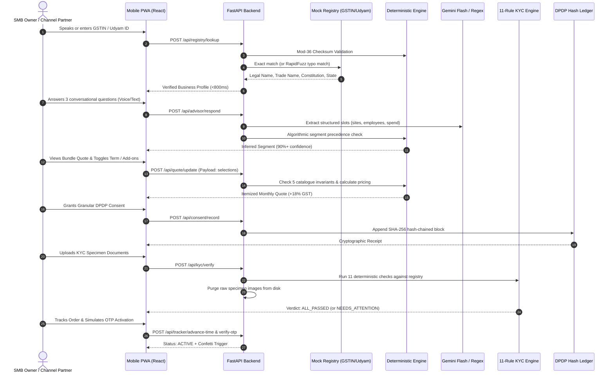

# Solution Architecture: Sync Passport

**System:** Sync Passport — GSTIN-First Digital SMB Onboarding  
**Competition:** Accel YTL Hackathon 2026 (Enterprise Track A: Project Udyam Digital)  
**Team:** `divya_tushar` (Divya Pratap Singh & Tushar Chaturvedi) — National Institute of Technology (NIT) Raipur  

---

## 1. End-to-End System Architecture

```mermaid
flowchart TD
    subgraph ClientLayer["Frontend Client Layer (Mobile PWA)"]
        UI["React 18 + Vite + TypeScript PWA<br/>Tailwind CSS (Red & Graphite Tokens)"]
        Voice["Web Speech API<br/>(Hindi & English ASR)"]
        Store["Zustand Session Store<br/>(Local Cache & Flow State)"]
        UI --- Voice
        UI --- Store
    end

    subgraph APILayer["FastAPI Gateway (Uvicorn REST API)"]
        RouterReg["/api/registry/*<br/>GSTIN & Udyam Lookup"]
        RouterAdv["/api/advisor/*<br/>Slot Extraction & Inference"]
        RouterQuote["/api/quote/*<br/>Deterministic Bundling Engine"]
        RouterKYC["/api/kyc/*<br/>11 Regulatory Rules Engine"]
        RouterTrack["/api/tracker/*<br/>Fulfillment & WhatsApp Simulator"]
        RouterLeads["/api/leads/*<br/>Back-Office Lead Triage"]
    end

    subgraph DeterministicEngine["Core Deterministic Rules Engine (No LLM)"]
        Mod36["Mod-36 GSTIN Checksum<br/>+ RapidFuzz Levenshtein Corrector"]
        SegInfer["Segment Precedence Engine<br/>(Sites >= 2, Staff >= 10, Keywords)"]
        PricingEngine["Deterministic Catalogue Rules<br/>(Eligibility, 15% 24M Discount, 18% GST)"]
        KYCRules["11 Regulatory Verification Checks<br/>(GST Status, 90-Day Utility, Name Fuzzy)"]
    end

    subgraph AIPipeline["Constrained AI & Vision Fallback"]
        LLM["Gemini Flash LLMProvider<br/>(Structured Slot Parsing Only)"]
        RegexFallback["Regex Deterministic Slot-Filler<br/>(100% Offline Demoday Failover)"]
        OCR["Pytesseract OCR + Monospace 0/O Disambiguation"]
    end

    subgraph SecurityDataLayer["DPDP Act 2023 Data & Storage Layer"]
        SQLite[("SQLModel SQLite (app.db)<br/>Journeys, Consent, Leads, Audit Logs")]
        Ledger["Append-Only Consent Ledger<br/>SHA-256 Chained Hash Verification"]
        PurgeWorker["Background Purge TTL Worker<br/>Ephemeral In-Memory RAM + 30m Auto-Scrub"]
    end

    subgraph MLPropensity["Predictive ML Model"]
        GBoost["Scikit-learn Gradient Boosting<br/>(ROC-AUC: 0.6527, Top-Decile Lift: 1.90x)"]
    end

    UI -->|JSON / REST| APILayer
    RouterReg --> Mod36
    RouterAdv --> LLM
    LLM -.->|Fallback| RegexFallback
    RouterAdv --> SegInfer
    RouterQuote --> PricingEngine
    RouterKYC --> OCR
    RouterKYC --> KYCRules
    RouterKYC --> Ledger
    RouterKYC --> PurgeWorker
    RouterLeads --> GBoost
    APILayer --> SQLite
```

---

## 2. Sequential Data Flow Diagram

---

## 3. Key Architectural Decisions

1. **The Golden Rule (Zero LLM Pricing or KYC):** The LLM is used strictly as a parser to convert conversational voice/text into structured integers. Product eligibility, bundling dependencies, and pricing are 100% deterministic Python code.
2. **Zero-Infra Portability:** Runs entirely in a single process via SQLite and local models. Zero cloud dependency ensures 100% demo reliability.
3. **DPDP Act 2023 Compliance:** Purpose-specific consent, ephemeral RAM OCR extraction, immediate file purge, and an immutable cryptographic SHA-256 chained audit trail.
